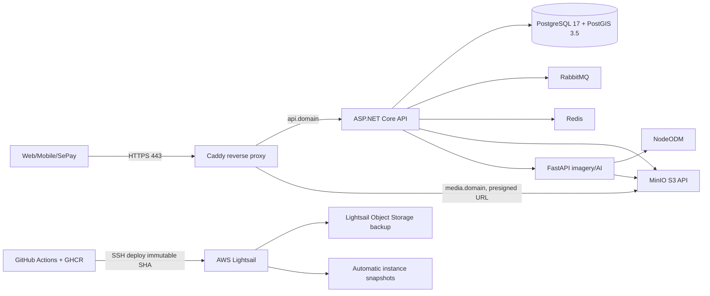

# AgriDrone — Kế hoạch triển khai demo lên AWS Lightsail

> **Ngày lập:** 2026-11-18  
> **Trạng thái:** `PROPOSED / PLAN_ONLY / NOT DEPLOYED`  
> **Môi trường mục tiêu:** Demo đồ án cho nhóm, tối đa khoảng 5 người dùng đồng thời  
> **Nhánh hiện tại khi khảo sát:** `LongTH`  
> **Ngân sách trần:** khoảng 100 USD/tháng  
> **Kiểm thử:** Không chạy `dotnet test` trong V3-01 đến V3-09; toàn bộ Integration/Acceptance Test để V3-10  
> **Lệnh kiểm tra code được phép trong phase hiện tại:** `dotnet build backend/AgriDrone.sln --no-restore --nologo`

## 1. Mục tiêu và quyết định đã chốt

Kế hoạch này hướng dẫn chuẩn bị repository, tạo hạ tầng, triển khai lần đầu, thiết lập CI/CD, HTTPS, SMTP, SePay, backup, giám sát và rollback cho AgriDrone.

Các quyết định đã được Owner/nhóm xác nhận:

| Hạng mục | Quyết định |
|---|---|
| Mục tiêu | Demo đồ án, không tuyên bố production-ready |
| Người dùng | Tối đa khoảng 5 người đồng thời |
| Tải AI | Tối đa 1 mission/ngày, khoảng 400 ảnh, tổng đầu vào khoảng 1 GB, chỉ 1 job chạy một lần |
| Compute | Một Lightsail Linux General Purpose 16 GB RAM, 4 vCPU, 320 GB SSD, public IPv4 |
| Region đề xuất | Singapore `ap-southeast-1` |
| Kiến trúc | Toàn bộ stack chạy trên một máy bằng Docker Compose |
| Database | PostgreSQL 17 + PostGIS 3.5 trong container, tạo database mới |
| Object storage live | MinIO trên Lightsail |
| AI | FastAPI và NodeODM chỉ truy cập nội bộ |
| Public entrypoint | Domain + HTTPS ngay từ đầu |
| Email | Bật SMTP; đề xuất Amazon SES SMTP cùng region |
| Payment | Chuẩn bị SePay Sandbox và IPN; activation bị chặn đến V3-10 |
| Delivery | GitHub Actions + GitHub Container Registry + SSH deployment |
| Backup | Database dump, MinIO backup ngoài instance và Lightsail snapshot |

## 2. Kết luận khảo sát repository

Repository hiện có các thành phần:

- ASP.NET Core .NET 10 modular monolith tại `backend/src/AgriDrone.Api`.
- PostgreSQL 17 + PostGIS 3.5, RabbitMQ 4.2.7, Redis 8.8.1, MinIO.
- FastAPI imagery/AI service tại `backend/services/metashape-service`.
- NodeODM để ghép ảnh và sinh orthophoto.
- Health endpoints: `/health/live`, `/health/ready`, `/health/minio`.
- SePay IPN endpoint: `POST /api/integrations/payments/sepay/ipn`.

Các khoảng trống phải xử lý trước deployment:

1. Chưa có Dockerfile cho ASP.NET API.
2. `compose.yaml` chỉ phục vụ local, chưa có API, reverse proxy, production secrets, resource limits hoặc log rotation.
3. Production CORS vẫn chứa localhost; chưa có danh sách allowed origins theo cấu hình.
4. Chưa gọi `UseForwardedHeaders`, nên scheme/client IP sau reverse proxy có thể sai.
5. Migration đang được phép chạy trong API startup; cách này không an toàn cho rollback và nhiều lần restart.
6. Swagger chỉ bật trong Development; không được đổi production thành Development chỉ để xem Swagger.
7. FastAPI Dockerfile chưa khóa chắc chắn CPU Torch/Ultralytics theo hướng dẫn trong chính `requirements.txt`.
8. NodeODM và MinIO đang dùng tag `latest`; deployment phải pin version hoặc image digest.
9. Chưa có workflow GitHub Actions hoặc deployment script.
10. Chưa có frontend trong repository. Các URL invitation/reset và SePay success/error/cancel chưa có trang đích thật.
11. MinIO presigned URL dành cho browser cần hostname HTTPS công khai; MinIO console vẫn phải giữ private.

## 3. Các gate bắt buộc trước khi go-live

### G0 — Migration gate đang mở

`PROJECT_MEMORY.md` ghi V3-04 chưa đóng M0/G14: chưa có bằng chứng migration history và migration hiện tại còn lẫn scope ngoài V3-04.

- Không chỉnh sửa migration lịch sử để “làm cho deploy chạy”.
- Không chạy migration trên môi trường demo có dữ liệu quan trọng trước khi migration chain được review.
- Vì database mục tiêu là database mới, phải rehearsal toàn bộ migration chain trên một PostgreSQL/PostGIS disposable database trước.
- Chỉ tạo môi trường demo chính thức sau khi rehearsal kết thúc thành công và có backup/rollback evidence.

### G1 — Tests vẫn deferred

- Trong V3-01 đến V3-09, không chạy `dotnet test`.
- CI chỉ restore/build/container-build/smoke-check theo giới hạn phase.
- Integration/Acceptance Test và payment activation chỉ thực hiện tại V3-10.

### G2 — Safety flags

Các giá trị sau phải giữ fail-closed:

```text
SurveyPayments__Enabled=false
LegacyFeatures__EnableDeprecatedEndpoints=false
PublicIntakeEnabled=false   # business-policy state trong database
```

SePay có thể được cấu hình trước bằng Sandbox credentials, nhưng không đổi `SurveyPayments__Enabled=true` trước V3-10.

### G3 — Thiếu trang redirect phía client

Hiện repository không có frontend route cho:

- invitation acceptance;
- password reset;
- SePay success;
- SePay error;
- SePay cancel.

Không bật payment chỉ bằng cách điền URL giả. Trước activation, nhóm phải cung cấp frontend thật hoặc thêm endpoint/page phù hợp và review security/UX.

## 4. Kiến trúc mục tiêu



### Public/private exposure

| Thành phần | Public? | Cách truy cập |
|---|---:|---|
| Caddy | Có | TCP 80/443 |
| ASP.NET API | Qua Caddy | `https://api.<domain>` |
| MinIO S3 API | Qua Caddy | `https://media.<domain>`; bucket private, presigned URL |
| MinIO Console | Không | SSH tunnel khi cần |
| FastAPI | Không | Docker network |
| NodeODM | Không | Docker network |
| PostgreSQL | Không | Docker network |
| RabbitMQ/management | Không | Docker network/SSH tunnel |
| Redis | Không | Docker network |
| SSH | Có giới hạn | Chỉ IP quản trị hoặc Lightsail browser SSH |

MinIO S3 API cần public qua HTTPS vì API hiện phát presigned upload/download URL cho client. Public ở đây không đồng nghĩa public bucket: anonymous access phải tắt, console không được expose và mọi object access dùng signed URL có TTL.

## 5. Dự toán chi phí

| Hạng mục | Ước tính/tháng | Ghi chú |
|---|---:|---|
| Lightsail 16 GB/4 vCPU/320 GB/public IPv4 | 84 USD | Máy chính |
| Lightsail Object Storage 100 GB | 3 USD | Backup ngoài instance |
| Instance snapshots | Biến đổi | 0,05 USD/GB-tháng; snapshot sau chỉ tính changed blocks |
| Amazon SES | Thấp theo usage | Demo email volume nhỏ |
| Domain | Theo registrar | Thường tính theo năm |
| **Tổng mục tiêu** | **Khoảng 90–100 USD** | Theo dõi snapshot/media growth |

Nếu snapshot changed blocks hoặc backup vượt quota, tổng có thể vượt 100 USD. Phải cấu hình AWS Budget ở mức 80/95/100 USD và cảnh báo dung lượng ở 70%/85%.

## 6. Danh sách thay đổi repository cần thực hiện

Đây là danh sách cho phase implementation sau plan; tài liệu này chưa thực hiện các thay đổi code/config bên dưới.

### Tạo mới

| File | Mục đích |
|---|---|
| `backend/src/AgriDrone.Api/Dockerfile` | Multi-stage build .NET 10, runtime non-root, healthcheck |
| `backend/.dockerignore` | Loại bin/obj/tests artifacts/secrets khỏi build context |
| `backend/.config/dotnet-tools.json` | Pin `dotnet-ef` cùng dòng EF Core 10 để tạo migration bundle |
| `compose.production.yaml` | Production stack, volumes, networks, limits, healthchecks |
| `infrastructure/caddy/Caddyfile` | HTTPS và reverse proxy API/MinIO |
| `infrastructure/env/.env.production.example` | Chỉ tên biến và placeholder, không chứa secret |
| `infrastructure/scripts/bootstrap-lightsail.sh` | Chuẩn bị Ubuntu, Docker, swap, thư mục |
| `infrastructure/scripts/deploy.sh` | Pull image SHA, migrate, deploy, verify, rollback |
| `infrastructure/scripts/backup.sh` | `pg_dump` và mirror MinIO sang backup bucket |
| `infrastructure/scripts/restore.sh` | Restore có xác nhận và target rõ ràng |
| `infrastructure/scripts/smoke-test.sh` | Kiểm tra HTTPS/health/container/database/broker/storage |
| `.github/workflows/ci.yml` | Restore/build/container build, không chạy test trước V3-10 |
| `.github/workflows/deploy-lightsail.yml` | Build/push GHCR và deploy release tag/manual approval |

### Sửa

| File | Thay đổi dự kiến |
|---|---|
| `backend/src/AgriDrone.Api/Program.cs` | Forwarded headers, configurable CORS, production proxy safety |
| `backend/src/AgriDrone.Api/appsettings.json` | Safe defaults; startup migration false cho production override |
| `backend/services/metashape-service/Dockerfile` | Pin dependencies, cài CPU Torch đúng thứ tự, healthcheck, non-root |
| `backend/services/metashape-service/requirements.txt` | Khóa version tương thích thay vì range mở |
| `.gitignore` | Chặn `.env.production`, dumps, backup metadata, TLS/private keys |
| `PROJECT_MEMORY.md` | Chỉ cập nhật sau khi deployment evidence thực sự tồn tại |

Không sửa business entities, financial history, migrations cũ hoặc safety flags trong công việc đóng gói hạ tầng.

## 7. Phase D0 — Chốt release artifact và migration strategy

### D0.1 Pin toolchain

1. Pin .NET SDK/runtime image theo .NET 10 patch đang dùng bởi repository.
2. Pin `dotnet-ef` cùng major/minor/patch với EF Core packages.
3. Pin NodeODM release thay cho `latest`.
4. Pin MinIO/Caddy image tag hoặc digest đã được smoke-test.
5. Tạo Software Bill of Materials hoặc ít nhất lưu image digest trong release evidence.

### D0.2 Tách migration khỏi API startup

Mục tiêu production:

```text
DatabaseInitialization__ApplyMigrationsOnStartup=false
```

API image phải kèm EF migration bundle được tạo trong build stage. Deployment chạy bundle một lần trước khi thay API container:

```bash
./efbundle --connection "$ConnectionStrings__AgriDrone"
```

Không truyền connection string trực tiếp trong command line của CI log. Deployment script đọc từ file root-only hoặc exported environment, tắt shell tracing và không in giá trị.

### D0.3 Rehearsal database mới

1. Dựng disposable `postgis/postgis:17-3.5`.
2. Chạy migration bundle từ migration đầu tiên đến mới nhất.
3. Xác nhận PostGIS extension, `__EFMigrationsHistory`, enum mappings, constraints và indexes.
4. Khởi động API với `ApplyMigrationsOnStartup=false`.
5. Gọi `/health/ready`.
6. Hủy disposable database sau khi lưu evidence.

Exit gate D0:

- Build 0 Warning/0 Error.
- Migration rehearsal pass trên fresh PostGIS.
- Không chỉnh migration lịch sử.
- M0/G14 được Owner/maintainer chấp nhận hoặc deployment vẫn đánh dấu blocked.

## 8. Phase D1 — Đóng gói ứng dụng

### D1.1 ASP.NET API image

Dockerfile phải:

1. Dùng multi-stage `sdk:10.0` → `aspnet:10.0`.
2. Restore theo `.sln`/central packages, sau đó publish Release.
3. Không copy `.env`, `.git`, test result hoặc local secret vào image.
4. Chạy bằng user không phải root.
5. Listen `http://0.0.0.0:8080`.
6. Có healthcheck đến `/health/live`.
7. Kèm migration bundle nhưng không tự chạy bundle trong API entrypoint.

### D1.2 Forwarded headers và CORS

`Program.cs` cần:

- cấu hình `ForwardedHeaders.XForwardedFor | XForwardedProto`;
- chỉ trust Docker reverse proxy network/known proxy, không trust tùy ý Internet;
- gọi `UseForwardedHeaders()` trước HTTPS redirection/auth;
- đọc allowed origins từ `Cors:AllowedOrigins`;
- không giữ `http://localhost:5173` trong production policy;
- `AllowCredentials` chỉ dùng với danh sách origin cụ thể, không wildcard.

Khi chưa có frontend, allowed origins để trống hoặc chỉ thêm origin thật của client; không thêm `*`.

### D1.3 FastAPI/NodeODM image

1. Chọn CPU inference vì Lightsail instance không có NVIDIA GPU.
2. Pin Ultralytics/Torch/Torchvision tương thích; không để pip tự đổi CPU/CUDA build ngoài ý muốn.
3. Pin model files bằng checksum SHA-256.
4. Chạy FastAPI bằng non-root user.
5. Mount temp workspace riêng và dọn sau job thành công/thất bại.
6. NodeODM chỉ nhận một task song song.
7. Giữ `fast-orthophoto=true`, `use-3dmesh=false`, cấu hình hiện tại ưu tiên demo resource.

### D1.4 Production Compose

`compose.production.yaml` phải có:

- hai network: `edge` cho Caddy và `internal` cho dịch vụ;
- chỉ Caddy publish `80:80` và `443:443`;
- không publish 5432/5672/15672/6379/9001/3000/8000;
- MinIO port 9000 chỉ đi qua Caddy `media.<domain>`;
- named volumes cho PostgreSQL, RabbitMQ, Redis, MinIO và Caddy certificates;
- healthchecks và `depends_on` theo health/completed conditions;
- restart policy `unless-stopped`;
- log rotation `max-size: 10m`, `max-file: 5`;
- image tags bằng immutable Git SHA/digest;
- secrets đọc từ server-side env file có permission 600.

Resource baseline ban đầu:

| Service | RAM mục tiêu | CPU mục tiêu | Ghi chú |
|---|---:|---:|---|
| API | 1,5 GB | 1 | Có thể burst |
| PostgreSQL | 3 GB | 1–1,5 | Không swap chủ động |
| RabbitMQ | 512 MB | 0,5 | Demo throughput |
| Redis | 512 MB | 0,25 | Set maxmemory policy rõ ràng |
| MinIO | 1 GB | 0,5 | Một disk demo |
| FastAPI/YOLO | 2 GB | 1–2 | Không chạy đồng thời nhiều model/job |
| NodeODM | Tối đa 10 GB RAM + swap | Tối đa 2,5–3 | Một task; theo dõi OOM |

Đây là giá trị khởi tạo, không phải bằng chứng capacity. Phải điều chỉnh dựa trên job 400 ảnh thật.

## 9. Phase D2 — Tạo AWS Lightsail

### D2.1 Chuẩn bị tài khoản

1. Bật MFA cho AWS root account.
2. Không dùng root account cho thao tác hằng ngày.
3. Tạo IAM admin/deployer phù hợp và bật MFA.
4. Cấu hình Billing contact và AWS Budget 80/95/100 USD.
5. Chọn một region duy nhất cho instance, SES và backup bucket: Singapore.

### D2.2 Tạo instance

Trong Lightsail Console:

1. Chọn **Create instance**.
2. Region: **Singapore**.
3. Platform: **Linux/Unix**.
4. Blueprint: **OS Only – Ubuntu 24.04 LTS** hoặc bản Ubuntu LTS đang được Lightsail hỗ trợ.
5. Plan: **16 GB RAM, 4 vCPU, 320 GB SSD, public IPv4**.
6. Tên: `agridrone-demo-sg`.
7. Bật automatic snapshots sau khi bootstrap hoàn tất.
8. Gắn tag: `Project=AgriDrone`, `Environment=Demo`, `Owner=<team>`.

### D2.3 Static IP và firewall

1. Tạo static IPv4 `agridrone-demo-ip` và attach vào instance.
2. IPv4 firewall:
   - TCP 80: all IPv4;
   - TCP 443: all IPv4;
   - TCP 22: chỉ IP quản trị; nếu IP động, ưu tiên Lightsail browser SSH.
3. Nếu bật IPv6, cấu hình firewall IPv6 tương đương; nếu chưa cần, không công bố AAAA record.
4. Xóa mọi public rule cho database, broker, cache, MinIO console, FastAPI và NodeODM.

Exit gate D2: chỉ 22/80/443 public và static IP đã attach.

## 10. Phase D3 — Domain, DNS và HTTPS

### D3.1 Domain layout

Sau khi mua domain, tạo:

```text
api.<domain>    A    <LIGHTSAIL_STATIC_IP>
media.<domain>  A    <LIGHTSAIL_STATIC_IP>
```

Nếu sau này có frontend:

```text
app.<domain>    -> hosting của frontend
```

Không chạy Caddy với domain placeholder. Đợi DNS A record resolve đúng static IP trước.

### D3.2 Caddy

Caddyfile mục tiêu:

```caddyfile
api.example.com {
    encode zstd gzip
    reverse_proxy api:8080 {
        health_uri /health/live
    }
}

media.example.com {
    reverse_proxy minio:9000
}
```

Yêu cầu:

- Persist `/data` và `/config` của Caddy.
- Mở 80/443 để ACME challenge và HTTPS.
- Không expose Caddy admin API ra Internet.
- Không proxy `/minio/ui` hoặc port 9001.
- Xác nhận Caddy giữ Host header khi proxy MinIO để signature không sai.

### D3.3 MinIO CORS và presigned URL

1. Bucket `agridrone-media` là private.
2. Disable anonymous policy.
3. CORS chỉ cho phép origin frontend thật, các method/header cần cho multipart upload.
4. API dùng `https://media.<domain>` để tạo presigned URL.
5. FastAPI/NodeODM dùng endpoint nội bộ `minio:9000`.
6. Nếu một option `ObjectStorage:Endpoint` không thể đồng thời đáp ứng internal operations và public presign, thêm cấu hình tách `InternalEndpoint`/`PublicEndpoint`; không hard-code URL.

Exit gate D3:

- `https://api.<domain>/health/live` trả 200.
- Certificate chain hợp lệ và tự renew.
- Presigned PUT/GET hoạt động từ máy ngoài Lightsail.
- MinIO console/AI/data ports không truy cập công khai.

## 11. Phase D4 — Bootstrap Ubuntu và Docker

Thực hiện bằng user Ubuntu có sudo; không đăng nhập root trực tiếp.

### D4.1 Update và hardening cơ bản

```bash
sudo apt-get update
sudo apt-get upgrade -y
sudo apt-get install -y ca-certificates curl gnupg jq git unzip fail2ban
sudo timedatectl set-timezone Asia/Bangkok
```

1. Thêm SSH public keys cho từng thành viên được phép.
2. Sau khi xác nhận key login hoạt động, tắt password authentication.
3. Không chia sẻ một private key chung qua chat/repository.
4. Bật unattended security upgrades nếu không xung đột maintenance window.

### D4.2 Cài Docker từ official repository

Theo tài liệu Docker Ubuntu, cài:

```bash
sudo apt-get install -y docker-ce docker-ce-cli containerd.io docker-buildx-plugin docker-compose-plugin
sudo systemctl enable --now docker
sudo docker run --rm hello-world
sudo docker compose version
```

Chỉ thêm user deploy vào group `docker` khi chấp nhận rằng quyền Docker tương đương root.

### D4.3 Thư mục runtime

```bash
sudo install -d -m 0750 -o deploy -g deploy /opt/agridrone
sudo install -d -m 0700 -o deploy -g deploy /opt/agridrone/secrets
sudo install -d -m 0750 -o deploy -g deploy /opt/agridrone/backups
sudo install -d -m 0750 -o deploy -g deploy /opt/agridrone/releases
```

### D4.4 Swap 16 GB

```bash
sudo fallocate -l 16G /swapfile
sudo chmod 600 /swapfile
sudo mkswap /swapfile
sudo swapon /swapfile
```

Thêm `/swapfile none swap sw 0 0` vào `/etc/fstab`, rồi cấu hình:

```text
vm.swappiness=15
vm.vfs_cache_pressure=50
```

Xác minh bằng `free -h` và `swapon --show` sau reboot. Swap giúp tránh OOM nhưng không thay thế RAM; job AI dùng swap sẽ chậm.

## 12. Phase D5 — Secrets và cấu hình runtime

### D5.1 Quy tắc

- File thật: `/opt/agridrone/secrets/.env.production`, mode `0600`.
- Không commit file thật, dump, key, certificate hoặc token.
- GitHub chỉ giữ deployment secrets; runtime business secrets ưu tiên nằm trên server.
- Tắt `set -x` trong script có secret.
- Rotate secret nếu từng xuất hiện trong Git, log, screenshot hoặc chat.

### D5.2 Nhóm biến bắt buộc

```dotenv
APP_DOMAIN=api.example.com
MEDIA_DOMAIN=media.example.com
ASPNETCORE_ENVIRONMENT=Production
ASPNETCORE_URLS=http://+:8080

POSTGRES_DB=agridrone
POSTGRES_USER=agridrone_app
POSTGRES_PASSWORD=<random-strong>
ConnectionStrings__AgriDrone=Host=postgres;Port=5432;Database=agridrone;Username=agridrone_app;Password=<same-secret>;Include Error Detail=false

DatabaseInitialization__ApplyMigrationsOnStartup=false
DatabaseInitialization__ValidateCoreMasterDataOnStartup=true

Jwt__Issuer=https://api.example.com
Jwt__Audience=agridrone-clients
Jwt__Secret=<at-least-32-random-bytes>

RabbitMq__Enabled=true
RabbitMq__HostName=rabbitmq
RabbitMq__UserName=agridrone
RabbitMq__Password=<random-strong>
RabbitMq__VirtualHost=agridrone

Redis__Enabled=true
Redis__ConnectionString=redis:6379,password=<random-strong>,abortConnect=false

ObjectStorage__Enabled=true
ObjectStorage__Endpoint=https://media.example.com
ObjectStorage__Bucket=agridrone-media
ObjectStorage__AccessKey=<random-strong>
ObjectStorage__SecretKey=<random-strong>
ObjectStorage__UseSsl=true

Metashape__Endpoint=http://metashape-service:8000
Metashape__BrowserOrigin=https://app.example.com

LegacyFeatures__EnableDeprecatedEndpoints=false
SurveyPayments__Enabled=false
SurveyPayments__Provider=sepay

SePay__Environment=Sandbox
SePay__MerchantId=<sandbox-merchant-id>
SePay__SecretKey=<sandbox-secret>
SePay__IpnSecretKey=<independent-random-secret>
SePay__SuccessUrl=https://app.example.com/payment/success
SePay__ErrorUrl=https://app.example.com/payment/error
SePay__CancelUrl=https://app.example.com/payment/cancel
SePay__PaymentCodePrefix=AGD

Identity__SystemAdminBootstrap__Enabled=true
Identity__SystemAdminBootstrap__Email=<team-admin-email>
Identity__SystemAdminBootstrap__FullName=<team-admin-name>
```

Các URL `app.example.com` chỉ được điền khi frontend route thật tồn tại. Trước đó giữ payment disabled.

### D5.3 Tạo secret

Dùng password generator/secret manager, ví dụ:

```bash
openssl rand -base64 48
```

Tạo secret độc lập cho PostgreSQL, RabbitMQ, Redis, MinIO, JWT và SePay IPN; không tái sử dụng.

## 13. Phase D6 — SMTP bằng Amazon SES

Đề xuất SES vì SMTP nằm cùng AWS region và hỗ trợ STARTTLS.

### D6.1 SES setup

1. Mở Amazon SES tại Singapore.
2. Verify domain identity.
3. Thêm DKIM records SES cung cấp vào DNS.
4. Cấu hình SPF/DMARC cho domain.
5. Tạo SES SMTP credentials riêng cho AgriDrone; không dùng AWS access key như SMTP password.
6. Nếu account còn SES Sandbox, verify địa chỉ nhận của nhóm; chỉ request production access khi thực sự cần gửi cho người ngoài.

### D6.2 Runtime values

```dotenv
Email__Smtp__Enabled=true
Email__Smtp__Host=email-smtp.ap-southeast-1.amazonaws.com
Email__Smtp__Port=587
Email__Smtp__SecurityMode=StartTls
Email__Smtp__Username=<ses-smtp-username>
Email__Smtp__Password=<ses-smtp-password>
Email__Smtp__FromAddress=no-reply@example.com
Email__Smtp__FromName=AgriDrone Demo
Email__Smtp__TimeoutSeconds=30
```

### D6.3 Acceptance

- API startup options validation pass.
- Gửi email thử đến verified recipient.
- Email không vào spam hoặc ít nhất DKIM/SPF pass.
- Log chỉ chứa recipient count, không chứa password/body nhạy cảm.
- Invitation/reset URL phải dùng domain thật và route thật trước khi demo luồng end-to-end.

## 14. Phase D7 — SePay Sandbox và HTTPS IPN

### D7.1 Chuẩn bị

1. Tạo SePay sandbox merchant.
2. Lưu riêng Merchant ID, merchant Secret Key và IPN Secret Key.
3. Cấu hình IPN auth type `SECRET_KEY`.
4. IPN URL:

```text
https://api.<domain>/api/integrations/payments/sepay/ipn
```

5. Chỉ dùng HTTPS public; không expose FastAPI/NodeODM cho SePay.

### D7.2 Gate activation

Trong phase hiện tại:

```dotenv
SePay__Environment=Sandbox
SurveyPayments__Provider=sepay
SurveyPayments__Enabled=false
```

Sau V3-10, một release/change-control riêng mới được phép:

1. Chạy payment acceptance matrix.
2. Xác nhận redirect pages có thật.
3. Xác nhận IPN idempotency/replay/reconciliation.
4. Backup database.
5. Đổi `SurveyPayments__Enabled=true` ở Sandbox trước.
6. Chỉ cân nhắc Production credentials sau nghiệm thu sandbox.

Không đưa live SePay key vào plan, GitHub repository hoặc CI logs.

## 15. Phase D8 — Triển khai lần đầu

### D8.1 Chuẩn bị release

1. Merge/review các file D1.
2. Chạy lệnh build được phép:

```powershell
dotnet build backend/AgriDrone.sln --no-restore --nologo
```

3. Build API/AI images.
4. Gắn image tag bằng full Git commit SHA.
5. Push images lên GHCR.
6. Ghi lại SHA, image digests và migration bundle checksum.

### D8.2 Trên server

1. Copy `compose.production.yaml`, `Caddyfile`, scripts và `.env.production` vào `/opt/agridrone`.
2. Login GHCR bằng read-only PAT qua `--password-stdin`.
3. Pull image SHA đã chọn.
4. Dựng data services trước:

```bash
docker compose --env-file secrets/.env.production -f compose.production.yaml up -d postgres rabbitmq redis minio
```

5. Chờ healthchecks pass.
6. Chạy MinIO init để tạo private bucket và CORS.
7. Chạy migration bundle một lần.
8. Khởi động API, FastAPI, NodeODM và Caddy.
9. Xem health/log trong thời gian quan sát tối thiểu 10–15 phút.

### D8.3 Bootstrap admin

Lần đầu để:

```dotenv
Identity__SystemAdminBootstrap__Enabled=true
```

Sau khi log xác nhận admin đã tồn tại và luồng đăng nhập/reset password hoạt động:

1. Đổi thành `false`.
2. Redeploy API.
3. Không giữ bootstrap enabled lâu dài.

### D8.4 Smoke checklist

- [ ] Tất cả containers healthy, không restart loop.
- [ ] `GET https://api.<domain>/health/live` = 200.
- [ ] `GET https://api.<domain>/health/ready` = 200.
- [ ] `GET https://api.<domain>/health/minio` = 200.
- [ ] TLS hợp lệ, HTTP redirect sang HTTPS.
- [ ] PostgreSQL có PostGIS và đúng migration history.
- [ ] RabbitMQ/Redis không public.
- [ ] MinIO bucket private.
- [ ] Presigned upload/download từ mạng ngoài hoạt động.
- [ ] SMTP gửi được mail thử.
- [ ] SePay IPN URL reachable qua HTTPS nhưng payment feature vẫn disabled.
- [ ] PublicIntake vẫn false.
- [ ] Không có secret trong log, image history hoặc repository.

## 16. Phase D9 — GitHub Actions CI/CD

### D9.1 Trigger strategy

Đề xuất:

- Pull request/push: chạy CI build.
- CD không tự deploy mọi push vào `LongTH`.
- Deploy bằng `workflow_dispatch` hoặc tag immutable dạng `demo-v*`.
- GitHub Environment: `lightsail-demo`.
- Bật reviewer/approval nếu GitHub plan hỗ trợ.
- Dùng `concurrency` để ngăn hai deployment chạy cùng lúc.

### D9.2 GitHub secrets

| Secret | Nội dung |
|---|---|
| `LIGHTSAIL_HOST` | Static IP hoặc SSH hostname |
| `LIGHTSAIL_USER` | User deploy |
| `LIGHTSAIL_SSH_KEY` | Dedicated deploy key |
| `LIGHTSAIL_KNOWN_HOSTS` | Pinned SSH host key |
| `GHCR_READ_TOKEN` | Read-only packages token cho server nếu image private |

Không đặt DB/JWT/SMTP/SePay secrets trong workflow nếu chúng đã nằm trên server.

### D9.3 Workflow stages

1. Checkout exact commit.
2. Restore/build .NET; chưa chạy tests trước V3-10.
3. Build API and AI images bằng official Docker actions.
4. Push `ghcr.io/<owner>/agridrone-api:<sha>` và `agridrone-ai:<sha>`.
5. Generate provenance/digest output.
6. SSH tới server bằng pinned host key.
7. Gọi `deploy.sh <sha>`.
8. Server thực hiện pre-deploy backup.
9. Pull images, run migration bundle, update services.
10. Smoke test; nếu fail, rollback application image tự động và báo đỏ.

Không dùng `latest` làm release identity.

## 17. Phase D10 — Backup và restore

### D10.1 Backup schedule

| Backup | Lịch đề xuất | Retention |
|---|---|---|
| PostgreSQL `pg_dump -Fc` | 01:00 ICT hằng ngày | 7 daily + 4 weekly |
| MinIO logical mirror | 01:30 ICT hằng ngày | 7 daily hoặc theo quota |
| Lightsail automatic snapshot | Sau logical backup | 7 bản tự động |
| Manual pre-deploy snapshot | Trước release lớn/migration | Giữ đến khi release ổn định |

Backup logical phải được chuyển sang Lightsail Object Storage 100 GB; chỉ để backup trên cùng ổ đĩa không được tính là disaster backup.

### D10.2 Backup script safety

Script phải:

1. `set -euo pipefail`, nhưng không `set -x`.
2. Ghi vào temp path cố định bên trong `/opt/agridrone/backups`.
3. Xác minh target bucket/prefix trước khi xóa retention.
4. Tạo checksum SHA-256.
5. Upload dump/checksum/manifest sang backup bucket.
6. Không log password/access key.
7. Gửi cảnh báo khi backup fail hoặc file bất thường nhỏ.

### D10.3 Restore drill

Mỗi tháng hoặc trước buổi bảo vệ:

1. Tạo database disposable.
2. Restore bản dump mới nhất.
3. Xác nhận migration history và row counts chính.
4. Restore một sample MinIO object và so checksum.
5. Ghi thời gian RPO/RTO thực tế.
6. Xóa disposable resources sau khi xác nhận target chính xác.

Không thử restore đè trực tiếp lên database đang chạy.

## 18. Phase D11 — Monitoring và vận hành

### D11.1 Lightsail/AWS

- CPU utilization alarm.
- Burst capacity alarm nếu metric có sẵn cho bundle.
- Instance status/availability notification.
- AWS Budget alerts ở 80, 95 và 100 USD.
- Email/SMS contact đã xác minh.

### D11.2 Host/container

Cron hoặc lightweight monitor kiểm tra:

- disk usage cảnh báo 70%, critical 85%;
- inode usage;
- RAM/swap;
- Docker container health/restart count;
- PostgreSQL backup age;
- TLS certificate status;
- `/health/live` và `/health/ready`;
- OOMKilled events;
- NodeODM temp directory size.

### D11.3 Log policy

- Docker JSON logs rotate 10 MB × 5 files/service.
- Không log JWT, payment secret, SMTP password, presigned URL đầy đủ hoặc raw personal data.
- Không public RabbitMQ management/MinIO console để “xem log cho tiện”. Dùng SSH tunnel.

## 19. Phase D12 — Capacity test cho mission 400 ảnh

Đây là smoke/capacity rehearsal, không thay thế V3-10 acceptance test.

1. Chọn bộ ảnh đại diện khoảng 400 ảnh/1 GB, không chứa dữ liệu nhạy cảm nếu có thể.
2. Xác nhận không có job khác.
3. Ghi baseline RAM, swap, disk free, Docker stats.
4. Chạy đúng một ODM job.
5. Theo dõi:
   - peak RAM và swap;
   - thời gian xử lý;
   - temp disk peak;
   - API p95/health trong lúc job chạy;
   - OOM/restart/error;
   - output checksum và upload MinIO.
6. Xác nhận temp assets được dọn sau job.
7. Nếu OOM/thrashing:
   - giảm NodeODM max concurrency;
   - giảm feature quality/resolution theo yêu cầu demo;
   - chia dataset nếu nghiệp vụ cho phép;
   - chạy worker Lightsail lớn hơn theo giờ cho buổi demo;
   - không tăng swap vô hạn trên root disk.

Exit gate D12: một job mẫu hoàn tất, API vẫn responsive và còn tối thiểu 25–30% disk trống.

## 20. Quy trình deploy thường xuyên

1. Tạo PR, review và build clean.
2. Tạo release tag `demo-vX.Y.Z` tại commit đã duyệt.
3. GitHub Actions build/push immutable images.
4. Reviewer approve GitHub Environment deployment.
5. Server tạo DB backup pre-deploy.
6. Pull images và kiểm tra digest.
7. Chạy migration bundle nếu có migration mới.
8. Update containers.
9. Smoke test.
10. Giữ previous SHA trong release metadata để rollback.
11. Quan sát ít nhất 15 phút trước khi đóng deployment.

## 21. Rollback

### 21.1 Chỉ code/image, không có migration phá vỡ tương thích

1. Chọn previous known-good SHA.
2. Update image tags về SHA trước.
3. `docker compose up -d` API/AI.
4. Smoke test.
5. Không restore database nếu schema vẫn backward-compatible.

### 21.2 Migration đã chạy

- Ưu tiên roll-forward migration sửa lỗi.
- Không tự động chạy EF down migration với dữ liệu tài chính/audit.
- Nếu migration phá hỏng fresh demo environment và chưa có dữ liệu quan trọng: restore database dump pre-deploy sau khi xác nhận Owner.
- Nếu đã có dữ liệu quan trọng: dừng write traffic, đánh giá migration/data, restore vào database mới để kiểm tra trước khi cutover.

### 21.3 Instance failure

1. Tạo instance mới từ snapshot gần nhất.
2. Attach/reassign static IP.
3. Restore logical PostgreSQL/MinIO backup nếu snapshot thiếu.
4. Xác nhận DNS, HTTPS, health và data checksum.
5. Chỉ mở traffic sau smoke test.

## 22. Checklist nghiệm thu cuối

### Repository

- [ ] API và AI images build reproducibly.
- [ ] Không dùng `latest` cho production compose.
- [ ] CI build 0 Warning/0 Error.
- [ ] Không chạy `dotnet test` trước V3-10.
- [ ] Không có secret trong Git history/artifact/image.
- [ ] Migration bundle/tool version được pin.

### AWS/server

- [ ] Đúng bundle 16 GB/4 vCPU/320 GB tại Singapore.
- [ ] Static IP attached.
- [ ] Firewall chỉ mở 22 có giới hạn, 80 và 443.
- [ ] 16 GB swap tồn tại sau reboot.
- [ ] Docker/Compose từ official repository.
- [ ] Automatic snapshots và budget alarms bật.

### Security/integration

- [ ] API và MinIO dùng certificate hợp lệ.
- [ ] MinIO bucket private, console không public.
- [ ] FastAPI/NodeODM/data services không public.
- [ ] SMTP SES/DKIM/SPF hoạt động.
- [ ] SePay IPN dùng HTTPS và secret độc lập.
- [ ] `SurveyPayments:Enabled=false` đến V3-10.
- [ ] `PublicIntakeEnabled=false` đến V3-10 acceptance.

### Data/operations

- [ ] Fresh database migration rehearsal pass.
- [ ] PostgreSQL backup upload ngoài instance.
- [ ] MinIO backup upload ngoài instance.
- [ ] Restore drill pass.
- [ ] Disk/RAM/swap/OOM monitoring hoạt động.
- [ ] Job 400 ảnh capacity rehearsal có evidence.
- [ ] Rollback previous SHA đã thử ở demo.

## 23. Thứ tự thực thi đề xuất

1. Đóng/review migration gate D0.
2. Thực hiện repository packaging D1.
3. Build clean bằng lệnh được phép.
4. Mua domain và tạo DNS plan.
5. Tạo Lightsail/static IP/firewall/budget.
6. Bootstrap Ubuntu/Docker/swap.
7. Tạo SES identity và SMTP credentials.
8. Tạo backup bucket.
9. Tạo runtime secrets trên server.
10. Build/push GHCR images.
11. Deploy data services và migration bundle.
12. Deploy API/AI/Caddy.
13. Xác minh HTTPS, MinIO presign, SMTP và health.
14. Thiết lập CI/CD, backup, monitoring.
15. Chạy capacity rehearsal 400 ảnh.
16. Đến V3-10 mới chạy full test suite và change-control bật SePay/public intake.

## 24. Tài liệu tham chiếu

- [AWS Lightsail instance bundles](https://docs.aws.amazon.com/lightsail/latest/userguide/amazon-lightsail-bundles.html)
- [AWS Lightsail firewall](https://docs.aws.amazon.com/lightsail/latest/userguide/understanding-firewall-and-port-mappings-in-amazon-lightsail.html)
- [AWS Lightsail automatic snapshots](https://docs.aws.amazon.com/lightsail/latest/userguide/amazon-lightsail-faq-snapshots.html)
- [AWS Lightsail object storage](https://docs.aws.amazon.com/lightsail/latest/userguide/amazon-lightsail-faq-buckets.html)
- [Docker Engine on Ubuntu](https://docs.docker.com/engine/install/ubuntu/)
- [Docker Compose plugin](https://docs.docker.com/compose/install/linux/)
- [GitHub Actions publishing Docker images](https://docs.github.com/en/actions/tutorials/publish-packages/publish-docker-images)
- [GitHub deployment environments](https://docs.github.com/en/actions/how-tos/deploy/configure-and-manage-deployments/manage-environments)
- [Caddy automatic HTTPS](https://caddyserver.com/docs/automatic-https)
- [Caddy reverse proxy](https://caddyserver.com/docs/caddyfile/directives/reverse_proxy)
- [Amazon SES Developer Guide](https://docs.aws.amazon.com/ses/latest/dg/Welcome.html)
- [SePay payment API overview](https://developer.sepay.vn/vi/cong-thanh-toan/API/tong-quan)
- [SePay IPN](https://developer.sepay.vn/vi/cong-thanh-toan/IPN)
- [OpenDroneMap hardware recommendations](https://github.com/OpenDroneMap/docs/blob/publish/source/installation.rst)

---

Kế hoạch này là deployment blueprint. Mọi trạng thái `PASS`, `DEPLOYED`, `BACKUP VERIFIED`, `PAYMENT ENABLED` hoặc `PRODUCTION READY` chỉ được cập nhật khi có evidence thực tế tương ứng.
