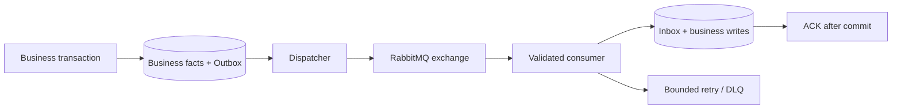

# RabbitMQ — .NET business, processing handoff và v3 compatibility

Updated **2026-11-10**. This guide describes target policies and reusable messaging mechanics, not a runtime deployment. Canonical rules: [Business Rules v3](Business-Rules-v3.md), [ADR 0018](../docs/adr/0018-v3-paid-map-combo-business-policy.md), [target contracts](../docs/contracts/survey-business-v3.md).

Design refinement **2026-11-11**: [ADR 0019](../docs/adr/0019-v3-01-model-contract-and-migration-design.md) / [locked design](../docs/domain/v3-01-locked-design.md) fix new family names/routing intent below. They are not deployed DTOs/bindings; old schemas and broker configuration remain unchanged.

## 1. Architecture

- BE1/BE2 capabilities run in the ASP.NET Core modular monolith. Synchronous coordination uses typed internal ports, not Java/HTTP loopback or separate business databases.
- FastAPI is an authenticated image/AI processing boundary. .NET persists job/source receipts and validates outputs before pending ingestion. FastAPI completion cannot directly release an Order or create official Plants.
- RabbitMQ transports versioned asynchronous integration events. Gateway/FastAPI/bank/email network calls do not join the business SQL transaction.

## 2. Invariants

1. Producer writes business facts + Outbox atomically; handlers do not directly publish before commit.
2. Dispatcher uses persistent messages, publisher confirms and mandatory routing. Publish failures retain a retryable Outbox record.
3. Consumer validates envelope/schema/context, claims Inbox, writes business state/audit atomically, ACKs only after commit.
4. MessageId dedup is necessary but insufficient. HandoffId/source revision, approval/release identity, publication ID, provider transaction and refund operation require business idempotency.
5. Same business identity with different content is a conflict, not silent success. Duplicate valid event returns stored receipt without duplicate financial/history writes.
6. Transient dependency/network errors retry with bounded policy; invalid schema/context/permanent business conflicts reach DLQ with reason. No infinite retries or swallowing partial writes before ACK.
7. Transaction failure rolls back Inbox and every staged business record. Logging an error then returning a permanent disposition must not commit a half-import.

## 3. Contract status and versions

| Artifact | Status |
|---|---|
| Mapping V1/V2/V3; PlantHealth V2/V3/V4; publication V1 | Released baseline schemas, immutable; deployment support varies by runtime |
| `health.analysis-ready.v4` | Existing strict pending-ingestion path; see [V4 fixtures](../docs/contracts/plant-health-v4/README.md) |
| Existing manual publication/notification/completion events | Historical runtime semantics, not proof of settlement-gated v3 release |
| SurveyMappingCandidatesReadyV1 / ComboAnalysisReadyV1 | Selected target pending families, mapping and Combo separated; no runtime declaration |
| SurveyResultReleasedV1 / SurveyResultWithdrawnV1 | Selected target outcome families; routing intent documented in locked contracts, no deployed binding |

Proposal/business-policy v3 does not rename messages to schema V3. A target `COMBO` service or internal approved first-map context must not be placed into a released V4 field whose validator only accepts legacy PlantHealth/published-map semantics. Define a new version when wire meaning/required fields/enum changes; review producer/consumer compatibility before enabling it.

New event envelope: messageId, eventType, schemaVersion, occurredAt UTC, correlationId, causationId, tenantId/actorId where applicable; payload includes exact Order/Farm/Mission/source/policy identities and immutable business revision/fingerprint. No raw media URLs, bank credentials or unbounded personal data.

## 4. Business boundaries

- Processing-ready message only stages pending candidates. No official profile creation/retirement, Owner-visible health or result release.
- Review approval freezes exact result revision and can trigger release evaluation. Approval alone is not publication or a completed paid service.
- V3 release coordinator commits publication/unlock, durable in-app notice, claim window, one-time service value, Order completion, audit and Outbox together. ApprovedAt may precede PublishedAt=UnlockedAt=NoticeCreatedAt.
- Async notification consumers deliver/project an existing durable notice. Their processing/retry timestamps never start or reset claims. Do not create only an Outbox intent and claim the canonical in-app notice already exists.
- Mission completion outcome consumes persisted release proof when its contract requires publication; flight/capture milestones remain independent of the customer waiting to pay.
- Refund reservation/completion are business facts with exact reason/amount/receipt identities. Manual bank transfer is reconciled outside SQL transaction; failed/uncertain transfers are not auto-retried as new transfers.

## 5. Topology, config and operational truth

Existing exchange names from the historical guide are `agridrone.integration`, `agridrone.integration.retry` and `agridrone.integration.dlx`. Treat actual appsettings, registered processors and deployed broker bindings as runtime truth; this document does not change or claim to inspect live queues.

For every consumer document its name, main queue/routing key/schema, retry queues/TTLs, DLQ, responsible capability and supported business-policy versions. Declaring a queue does not register a running processor. A shadow consumer needs a separate queue/binding; two consumers on the same queue compete and do not receive identical copies for comparison.

Startup/readiness should validate configured consumers and required dependencies without inventing fake service/model/master-data evidence. Operational dashboards track Outbox pending/lease failures, Inbox retries, DLQ depth, source/review/release lag, duplicate/conflict counts and reconciliation differences.

## 6. Retry, redrive and retention

- Preserve message/business identities for retransmission; reprocess producing a genuine new result uses a new source revision and supersedes relation.
- Missing dependency retries are bounded; out-of-order older revisions cannot overwrite a locked/approved/released result. Invalid tenant/source/policy goes permanent with audit.
- Redrive requires authorized actor/reason and verified current context. Do not edit the source payload/Inbox receipt to force acceptance.
- Inbox retention cannot be the only dedup store for money/release. Durable business receipts survive broker redelivery after Inbox cleanup.
- Raw imagery/GNSS/source outputs/reports referenced by Baseline/profiles/claims/corrections stay protected; drain old queues/DLQs only after producer cutover, replay tests and retention gates.
- Keep historical golden JSON/hash behavior and released schemas unchanged. No global enum rename or fake old-to-new service backfill.

## 7. Future implementation checklist

- [ ] Contract review for MAP/COMBO, internal approved map vs public Baseline, review/invoice/policy revisions and release proof.
- [ ] Compatible consumer first, new producer afterward; explicit legacy disposition, queue drain/replay/rollback evidence.
- [ ] Inbox + full-batch atomicity, message/business dedup, envelope/payload strict validation.
- [ ] Publication/notice/window/revenue committed once under concurrent approval/payment triggers.
- [ ] Bounded retry/DLQ, crash/lease recovery, redrive audit and evidence-safe retention.
- [ ] Real broker/DB rollback/concurrency checks and Owner visibility tests from [v3 acceptance](../docs/testing/v3-business-acceptance.md).

These are future code/release checks. No producer/consumer/configuration or deployed event is modified by this documentation rebaseline.
