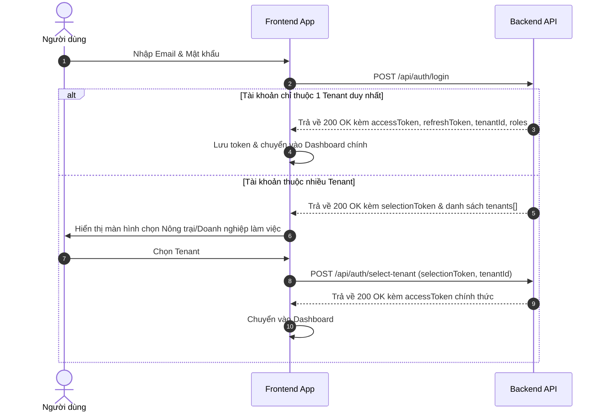

# AgriDrone — Tài liệu Tích hợp API Backend dành cho Frontend (Web / Mobile)

> **Môi trường:** Live AWS Lightsail Demo (Singapore `ap-southeast-1`)  
> **Phiên bản Backend:** .NET 10, Clean Architecture, PostgreSQL 17 + PostGIS 3.5  
> **Cập nhật lần cuối:** 2026-11-21  
> **Trạng thái:** Backend Core đã UP & HEALTHY 100%, sẵn sàng ghép nối.

---

## 1. Thông tin Kết nối & Base URLs

Toàn bộ dịch vụ Backend chạy sau Caddy Reverse Proxy với chứng chỉ **HTTPS SSL hợp lệ tự động**:

| Mục đích | URL | Ghi chú |
|---|---|---|
| **API Base URL** | `https://agridrone-api.duckdns.org` | Điểm truy cập chính cho mọi API RESTful |
| **Media / S3 Storage URL** | `https://agridrone-media.duckdns.org` | Máy chủ lưu trữ ảnh flycam, bản đồ trắc địa (MinIO S3) |
| **Health Check (Liveness)** | `https://agridrone-api.duckdns.org/health/live` | Trả về `Healthy` (HTTP 200) |
| **Health Check (Readiness)** | `https://agridrone-api.duckdns.org/health/ready` | Kiểm tra kết nối DB, RabbitMQ, Redis |
| **Health Check (Storage)** | `https://agridrone-api.duckdns.org/health/minio` | Kiểm tra MinIO Object Storage |

---

## 2. File Cấu hình Môi trường Frontend (`.env`)

Tùy vào công nghệ Frontend mà bạn đang sử dụng, hãy copy cấu hình tương ứng vào thư mục root của dự án FE:

### Dành cho React (Vite): `.env.production` hoặc `.env.local`
```ini
VITE_API_BASE_URL=https://agridrone-api.duckdns.org
VITE_MEDIA_BASE_URL=https://agridrone-media.duckdns.org
VITE_APP_ENV=production
```

### Dành cho Next.js: `.env.production` hoặc `.env.local`
```ini
NEXT_PUBLIC_API_BASE_URL=https://agridrone-api.duckdns.org
NEXT_PUBLIC_MEDIA_BASE_URL=https://agridrone-media.duckdns.org
NEXT_PUBLIC_APP_ENV=production
```

### Dành cho Flutter / React Native:
```dart
const String apiBaseUrl = "https://agridrone-api.duckdns.org";
const String mediaBaseUrl = "https://agridrone-media.duckdns.org";
```

---

## 3. Cấu hình CORS (BẮT BUỘC KHI GHÉP NỐI)

Backend áp dụng chính sách bảo mật CORS nghiêm ngặt trong môi trường Production:
- Chỉ các domain nằm trong danh sách trắng (`Cors:AllowedOrigins`) mới được phép gửi request kèm Cookie/Header.
- Mặc định server đã mở cho: `http://localhost:5173`, `http://localhost:3000`.

> [!IMPORTANT]
> **Khi bạn deploy Frontend** (lên Vercel, Netlify, Cloudflare Pages hoặc domain riêng như `https://agridrone-fe.vercel.app`):
> Bạn chỉ cần mở file `/opt/agridrone/secrets/.env.production` trên server Lightsail và thêm dòng:
> ```ini
> Cors__AllowedOrigins__0=https://agridrone-fe.vercel.app
> Cors__AllowedOrigins__1=http://localhost:5173
> ```
> Sau đó khởi động lại API: `sudo docker compose --env-file secrets/.env.production -f compose.production.yaml up -d api`

---

## 4. Chuẩn Xác thực (Authentication & Authorization)

Hệ thống sử dụng **JWT Bearer Token**. Mọi API yêu cầu đăng nhập cần đính kèm Header:
```http
Authorization: Bearer <access_token>
Content-Type: application/json
Accept: application/json
```

### 4.1. Các vai trò (Roles) trong hệ thống
- `SystemAdmin`: Quản trị viên hệ thống (quản lý người dùng, cấu hình giá thương mại, phê duyệt hoàn tiền).
- `SystemManager`: Quản lý vận hành (điều phối phi vụ bay, checklist an toàn drone, review kết quả AI).
- `TenantOwner`: Chủ sở hữu trang trại (khách hàng nông dân/doanh nghiệp đặt khảo sát, xem bản đồ số, theo dõi cây trồng).
- `FarmManager`: Quản lý khu đất/vườn cây được chủ trang trại ủy quyền.

---

### 4.2. Luồng Đăng nhập (Multi-Tenant Login Flow)



#### API 1: Đăng nhập
- **Method**: `POST`
- **Endpoint**: `/api/auth/login`
- **Request Body**:
  ```json
  {
    "email": "owner@example.com",
    "password": "Password123!"
  }
  ```
- **Response (Trường hợp 1 Tenant)**:
  ```json
  {
    "requiresTenantSelection": false,
    "accessToken": "eyJhbGciOiJIUzI1NiIsIn...",
    "refreshToken": "d8f92a10...",
    "expiresAt": "2026-11-21T06:00:00Z",
    "tenantId": "3fa85f64-5717-4562-b3fc-2c963f66afa6",
    "roles": ["TenantOwner"]
  }
  ```
- **Response (Trường hợp nhiều Tenant)**:
  ```json
  {
    "requiresTenantSelection": true,
    "selectionToken": "eyJhbGciOiJIUzI1NiIsIn...",
    "tenants": [
      {
        "id": "3fa85f64-5717-4562-b3fc-2c963f66afa6",
        "name": "Nông trại Thanh Long Hoàng Long 1"
      },
      {
        "id": "7ca95f64-1111-2222-3333-4c963f66bba7",
        "name": "Hợp tác xã Nông nghiệp Hàm Thuận Bắc"
      }
    ]
  }
  ```

#### API 2: Chọn Tenant (Nếu cần)
- **Method**: `POST`
- **Endpoint**: `/api/auth/select-tenant`
- **Request Body**:
  ```json
  {
    "selectionToken": "eyJhbGciOiJIUzI1NiIsIn...",
    "tenantId": "3fa85f64-5717-4562-b3fc-2c963f66afa6"
  }
  ```
- **Response**: Trả về `accessToken` và `roles` chính thức theo tenant đã chọn.

#### API 3: Quên mật khẩu & Đặt lại mật khẩu
- **Quên mật khẩu**: `POST /api/auth/forgot-password`  
  `Body: { "email": "user@example.com" }` -> Trả về HTTP 202 Accepted.
- **Đặt lại mật khẩu**: `POST /api/auth/reset-password`  
  `Body: { "token": "...", "newPassword": "...", "confirmPassword": "..." }` -> Trả về HTTP 200 OK.

---

## 5. Danh mục API Nghiệp vụ Cốt lõi (Core Business Endpoints)

### 5.1. Khảo sát Công khai (Public Survey Booking — Không cần đăng nhập)
Dành cho khách hàng vãng lai vào website đặt lịch khảo sát:

| Endpoint | Method | Mô tả |
|---|---|---|
| `/api/v3/public/survey-services` | `GET` | Lấy danh mục dịch vụ (gói `MAP` tạo bản đồ, gói `COMBO` bản đồ + phát hiện bệnh, đơn giá trụ, mức cọc) |
| `/api/v3/public/survey-requests` | `POST` | Gửi yêu cầu đặt lịch khảo sát mới (trả về `trackingCode`) |
| `/api/v3/public/survey-requests/{trackingCode}` | `GET` | Tra cứu tiến độ đơn khảo sát theo mã tracking |

---

### 5.2. Chủ vườn / Khách hàng (Tenant Owner Portal)
Yêu cầu header: `Authorization: Bearer <TOKEN>` (Role: `TenantOwner`)

| Endpoint | Method | Mô tả |
|---|---|---|
| `/api/v3/tenant-owner/survey-orders` | `GET` | Danh sách đơn khảo sát của mình |
| `/api/v3/tenant-owner/survey-orders/{id}` | `GET` | Chi tiết đơn: trạng thái, số trụ thanh toán tạm tính, cọc đã trả |
| `/api/farms` | `GET` | Danh sách trang trại / vườn cây của tôi |
| `/api/farms/{farmId}/base-maps` | `GET` | Lấy danh sách các phiên bản bản đồ số trang trại (`FarmBaseMapVersion`) |
| `/api/farms/{farmId}/plants` | `GET` | Danh sách hồ sơ cây trồng / trụ thanh long (`PlantProfile`) |
| `/api/farms/{farmId}/plant-health` | `GET` | Dữ liệu sức khỏe cây trồng, mật độ sâu bệnh, khuyến nghị xử lý |

---

### 5.3. Điều hành & Phi vụ bay (System Manager / Field Team)
Yêu cầu header: `Authorization: Bearer <TOKEN>` (Role: `SystemManager` hoặc `SystemAdmin`)

| Endpoint | Method | Mô tả |
|---|---|---|
| `/api/v3/system-manager/survey-orders` | `GET` | Danh sách đơn đặt lịch cần xếp lịch bay & xử lý |
| `/api/v3/system-manager/survey-orders/{id}/appointment` | `POST` | Xếp lịch hẹn khảo sát thực địa |
| `/api/system/drones` | `GET` | Danh sách drone của hệ thống |
| `/api/system/missions` | `GET` | Danh sách phi vụ bay khảo sát |
| `/api/system/missions/{id}/preflight` | `POST` | Gửi checklist an toàn trước khi cất cánh |
| `/api/system/missions/{id}/media` | `GET` | Danh sách ảnh flycam chụp được |
| `/api/plant-health-review` | `GET` | Danh sách kết quả AI cần chuyên gia nông nghiệp đánh giá/review |
| `/api/system-manager/farm-base-maps/{id}/internal-approval` | `POST` | Duyệt nội bộ phiên bản bản đồ số |

---

## 6. Hiển thị Ảnh & Bản đồ Trực giao (Media & Presigned S3 URLs)

- Toàn bộ media flycam, ảnh trực giao Orthophoto GeoTIFF, ảnh bệnh cây trồng được quản lý trên MinIO với cơ chế bảo mật Private.
- **Cách hiển thị**: Backend sinh sẵn **Presigned URL** có chữ ký bảo mật SigV4 trỏ qua domain `https://agridrone-media.duckdns.org/...`.
- **Frontend chỉ cần**:
  - Gán trực tiếp link này vào thẻ `` trong HTML/React/Vue.
  - Hoặc truyền link GeoTIFF/PNG vào các thư viện bản đồ như **Leaflet**, **OpenLayers**, **MapLibre GL** để hiển thị lớp bản đồ trực giao nông trại.
  - Link Presigned có thời hạn hiệu lực (mặc định 60 phút).

---

## 7. Định dạng Chuẩn Response & Xử lý Lỗi (Result Pattern)

Backend không dùng HTTP 500 thông thường để báo lỗi nghiệp vụ mà trả về chuẩn **RFC 7807 Problem Details**:

### Khi thành công (HTTP 200 / 201)
```json
{
  "id": "3fa85f64-5717-4562-b3fc-2c963f66afa6",
  "status": "AwaitingDeposit",
  "totalAmount": 1500000,
  "depositAmount": 100000
}
```

### Khi có lỗi nghiệp vụ (HTTP 400 / 404 / 422)
```json
{
  "type": "https://tools.ietf.org/html/rfc7231#section-6.5.1",
  "title": "Invalid Operation",
  "status": 400,
  "detail": "Đơn hàng đang ở trạng thái InFlight, không thể hủy trước khi có báo cáo kỹ thuật.",
  "code": "ORDER_CANNOT_BE_CANCELLED"
}
```
> [!TIP]
> Frontend nên đọc trường `detail` để hiển thị Toast thông báo lỗi tiếng Việt thân thiện cho người dùng, và đọc trường `code` nếu cần phân nhánh logic hiển thị trên UI.

---

## 8. Hướng dẫn Test nhanh Kết nối từ Frontend

Bạn có thể viết một đoạn mã nhỏ để test kết nối từ console của trình duyệt hoặc file test Axios / Fetch:

```javascript
// Test kết nối backend từ Frontend
async function checkBackendConnection() {
  const API_URL = "https://agridrone-api.duckdns.org";
  
  try {
    const res = await fetch(`${API_URL}/health/live`);
    const status = await res.text();
    console.log("Trạng thái Backend:", status); // Kỳ vọng: "Healthy"
    
    const servicesRes = await fetch(`${API_URL}/api/v3/public/survey-services`);
    const services = await servicesRes.json();
    console.log("Danh mục gói dịch vụ khảo sát:", services);
  } catch (error) {
    console.error("Lỗi kết nối Backend:", error);
  }
}

checkBackendConnection();
```

---

## 9. Liên hệ Hỗ trợ Backend
- **Nhánh triển khai chính:** `main` (tự động cập nhật qua GitHub Actions CD).
- **Nhánh phát triển tính năng:** `LongTH`.
- **Người phụ trách Backend:** @LongTH.
